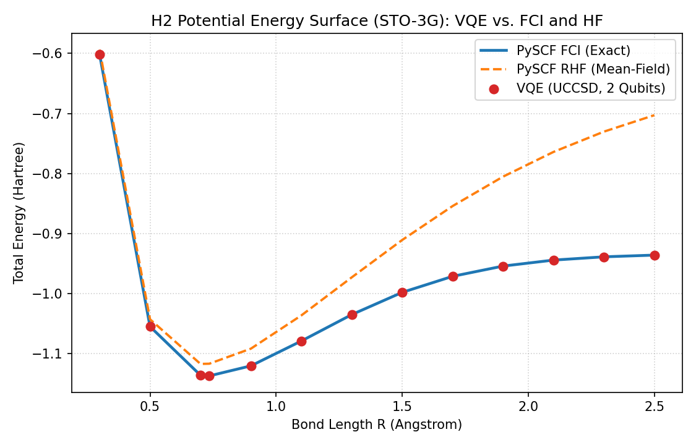

# Q-Med: Quantum Chemistry Eligibility & VQE Decision-Support Prototype

**Q-Med** is a scientific-computing research and educational decision-support prototype that evaluates **when** quantum chemistry simulation (Variational Quantum Eigensolver, **VQE**) is worth running for a molecule, and benchmarks ideal and noisy VQE circuits against live **PySCF** Hartree–Fock (HF) and exact Full Configuration Interaction (FCI / CASCI) baselines in matched active spaces.

> **Disclaimer:** Q-Med is a research and educational decision-support prototype for evaluating quantum chemistry simulation trade-offs. It is **not** a clinical, diagnostic, or drug-approval tool.

---

## Core Architecture & Pipeline

1. **Molecular Validation & RDKit Descriptors (`qmed/molecules.py`):**
   - Validates input SMILES strings and computes `MW`, `LogP`, `HBD`, `HBA`, `TPSA`, `rotatable_bonds`, and `QED`.
   - Loads explicit 3D benchmark geometries (`STO-3G`) from `data/benchmarks.json` for $\text{H}_2$ ($0.735\text{ \AA}$), $\text{LiH}$ ($1.595\text{ \AA}$), and $\text{H}_2\text{O}$ ($r_{\text{OH}} = 0.9572\text{ \AA}$, $\angle_{\text{HOH}} = 104.52^\circ$).
2. **Rule-Based Quantum Eligibility Engine — QEE v1 (`qmed/qee.py`, `qmed/active_space.py`):**
   - Analytically estimates frozen-core active-space dimensions $(N_e, N_o)$, mapped qubit counts, spin-conserving UCCSD parameter counts, and decomposed gate depths.
   - Routes molecules to `CLASSICAL_ONLY`, `SIMULATED_QUANTUM`, `HYBRID`, or `DEFERRED` using explicit thresholds in `qmed/config.py` (`MAX_SIMULATED_QUBITS = 12`, `MAX_CIRCUIT_DEPTH = 5000`, `MAX_HYBRID_FULL_QUBITS = 24`) with human-readable reasons and warnings.
3. **Matched Active-Space Classical Baselines (`qmed/classical.py`):**
   - Computes Restricted / Restricted Open-Shell Hartree–Fock (`RHF`/`ROHF`) and exact diagonalization (`FCI`/`CASCI`) live via **PySCF** in the exact same active space as the quantum circuit.
4. **Seeded Ideal & Noisy VQE Runner (`qmed/vqe_runner.py`):**
   - Maps second-quantized electronic Hamiltonians to qubits via **Parity mapping with two-qubit $\mathbb{Z}_2$ reduction** for $\text{H}_2$ and $\text{LiH}$, and **Jordan–Wigner mapping** otherwise.
   - Supports **UCCSD** (with **EfficientSU2** hardware-efficient fallback), exact noiseless statevector simulation (`AerEstimator(approximation=True)`), custom **1Q/2Q depolarizing + symmetric readout error** models (`p_1q = 0.001`, `p_2q = 0.010`, `p_ro = 0.015`), and calibration-based fake backends (`GenericBackendV2`).
5. **Multi-Seed Benchmark, Reliability Capping & Advantage Verdict (`qmed/benchmark.py`):**
   - Aggregates runs across $\ge 5$ random seeds (`42, 43, 44, 45, 46`), reporting mean VQE energy, mean absolute error vs. matched FCI/CASCI, sample standard deviation $\pm\sigma$ across seeds, active-space truncation error (`active_space_error_mHa`), variational-bound checks (`1e-8 Ha` guard), reliability label (`HIGH`, `MEDIUM`, `LOW`, `UNRELIABLE`, `INVALID`), and quantum-advantage verdict (`NO_DEMONSTRATED_ADVANTAGE`, `INSUFFICIENT_EVIDENCE`, `POTENTIAL_ADVANTAGE`, `DEMONSTRATED_ADVANTAGE`).
6. **SQLite Persistence & Deterministic Experiment Replay (`qmed/storage.py`):**
   - Stores every single-seed run, multi-seed aggregate, and QEE decision in SQLite (`qmed_experiments.db`) and provides `replay_experiment(id)` to re-execute any saved configuration and verify deterministic reproducibility.

---

## Executed Results Tables (All Numbers from Live Runs)

### 1. Classical PySCF Baselines (`STO-3G`)

| Molecule | Geometry | Regime / Active Space | Spatial Orbitals | HF Energy (Ha) | Exact FCI / CASCI Energy (Ha) | Correlation Energy $E_{\text{corr}}$ (mHa) | Active-Space Truncation Error $\Delta E_{\text{AS}}$ (mHa) | PySCF Runtime (s) |
| :--- | :--- | :--- | :---: | :---: | :---: | :---: | :---: | :---: |
| **`H2`** | $R = 0.735\text{ \AA}$ | All-Electron / Frozen-Core `(2e, 2o)` | `2` | `-1.11699900` | `-1.13730604` | `-20.3070` | `0.0000` | `0.04` |
| **`LiH`** | $R = 1.595\text{ \AA}$ | All-Electron `(4e, 6o)` | `6` | `-7.86202386` | `-7.88240193` | `-20.3781` | — | `0.05` |
| **`LiH`** | $R = 1.595\text{ \AA}$ | Frozen-Core `(2e, 5o)` *(Li $1s^2$ frozen)* | `5` | `-7.86202386` | `-7.88217451` | `-20.1506` | `+0.2274` *(vs. all-elec)* | `0.03` |
| **`H2O`** | $r_{\text{OH}} = 0.9572\text{ \AA}, 104.52^\circ$ | All-Electron `(10e, 7o)` | `7` | `-74.96292818` | `-75.01298039` | `-50.0522` | — | `0.06` |
| **`H2O`** | $r_{\text{OH}} = 0.9572\text{ \AA}, 104.52^\circ$ | Full Frozen-Core `(8e, 6o)` *(O $1s^2$ frozen)* | `6` | `-74.96292818` | `-75.01232538` | `-49.3972` | `0.0000` *(valence ref)* | `0.04` |
| **`H2O`** | $r_{\text{OH}} = 0.9572\text{ \AA}, 104.52^\circ$ | Reduced `HYBRID` `(4e, 4o)` *(MOs `#3..#6`)* | `4` | `-74.96292818` | `-74.97034075` | `-7.4126` | **`+41.9846`** *(vs. 8e,6o)* | `0.03` |

---

### 2. Multi-Seed Ideal vs. Noisy VQE Benchmark Results (`Seeds: 42, 43, 44, 45, 46`)

| Molecule | Active Space | Mapping ($N_q$) | Ansatz (`Params`) | Depth / Gates | Simulation Mode (`Optimizer`) | Matched FCI / CASCI (Ha) | Mean VQE Energy (Ha) | $\lvert\text{Mean Error}\rvert$ (mHa) | Seed Std $\pm\sigma$ (mHa) | $\Delta E_{\text{AS}}$ (mHa) | Reliability | Advantage Verdict | Mean Runtime / Seed (s) |
| :--- | :--- | :--- | :--- | :---: | :--- | :---: | :---: | :---: | :---: | :---: | :---: | :--- | :---: |
| **`H2`** | `(2e, 2o)` | Parity 2Q-red (`2q`) | `UCCSD` (`3`) | `15` / `21` | `ideal` (`SLSQP`) | `-1.137306` | `-1.137306` | **`0.0001`** | `0.0001` | `0.00` | **`HIGH`** | `NO_DEMONSTRATED_ADVANTAGE` | `0.14` |
| **`H2`** | `(2e, 2o)` | Parity 2Q-red (`2q`) | `UCCSD` (`3`) | `15` / `21` | `depolarizing_readout` (`COBYLA`, 1024 shots) | `-1.137306` | `-1.102773` | **`34.5332`** | `0.0004` | `0.00` | **`LOW`** | `NO_DEMONSTRATED_ADVANTAGE` | `2.09` |
| **`H2`** | `(2e, 2o)` | Parity 2Q-red (`2q`) | `UCCSD` (`3`) | `15` / `21` | `fake_generic_v2_2q` (`COBYLA`, 1024 shots) | `-1.137306` | `-1.120008` | **`17.2982`** | `6.1865` | `0.00` | **`LOW`** | `NO_DEMONSTRATED_ADVANTAGE` | `1.80` |
| **`LiH`** | `(2e, 5o)` | Parity 2Q-red (`8q`) | `UCCSD` (`24`) | `1771` / `3256` | `ideal` (`SLSQP`) | `-7.882175` | `-7.882174` | **`0.0006`** | `0.0002` | `0.00` | **`HIGH`** | `NO_DEMONSTRATED_ADVANTAGE` | `49.05` |
| **`LiH`** | `(2e, 5o)` | Parity 2Q-red (`8q`) | `UCCSD` (`24`) | `1771` / `3256` | `depolarizing_readout` (`COBYLA`, 512 shots) | `-7.882175` | `-5.906403` | **`1975.7717`** | `10.8173` | `0.00` | **`UNRELIABLE`** | `INSUFFICIENT_EVIDENCE` | `11.32` |
| **`H2O`** | `(4e, 4o)` *Option A* | Jordan–Wigner (`8q`) | `UCCSD` (`26`) | `2005` / `3428` | `ideal` (`SLSQP`) | `-74.970341` | `-74.970311` | **`0.0301`** | `0.0116` | `+41.98` | **`MEDIUM`** *(capped)* | `NO_DEMONSTRATED_ADVANTAGE` | `33.10` |
| **`H2O`** | `(4e, 4o)` *Option A* | Jordan–Wigner (`8q`) | `UCCSD` (`26`) | `2005` / `3428` | `depolarizing_readout` (`COBYLA`, 256 shots) | `-74.970341` | `-73.180808` | **`1789.5326`** | `25.4987` | `+41.98` | **`UNRELIABLE`** | `NO_DEMONSTRATED_ADVANTAGE` | `6.23` |
| **`H2O`** | `(8e, 6o)` *Option B* | Parity 2Q-red (`10q`) | `EfficientSU2(reps=1)` (`40`) | `11` / `90` | `ideal` (`COBYLA`, seeds `42..44`, 120 evals) | `-75.012325` | `-74.973517` | **`38.8087`** | `8.8912` | `0.00` | **`LOW`** *(ansatz demo)* | `NO_DEMONSTRATED_ADVANTAGE` | `0.81` |

---

### 3. Quantum Eligibility Engine (QEE v1) Routing Table

| Molecule | Input / SMILES | Formula (`MW`) | Frozen-Core Space | Mapped Qubits | UCCSD Params | Est. Circuit Depth | QEE v1 Decision | Primary Routing Reason |
| :--- | :--- | :--- | :---: | :---: | :---: | :---: | :---: | :--- |
| **Helium** | `[He]` | $\text{He}$ (`4.00`) | `(2e, 1o)` | `2` | `0` | `0` | **`CLASSICAL_ONLY`** | All STO-3G orbitals doubly occupied (`0` virtual orbitals, `0` excitations); HF is exact. |
| **Hydrogen** | `H2` / `[H][H]` | $\text{H}_2$ (`2.02`) | `(2e, 2o)` | `2` | `3` | `15` | **`SIMULATED_QUANTUM`** | `2 <= 12` qubits and depth `15 <= 5000` fit comfortably in full active-space simulation. |
| **Lithium Hydride** | `LiH` / `[LiH]` | $\text{HLi}$ (`7.95`) | `(2e, 5o)` | `8` | `24` | `1,771` | **`SIMULATED_QUANTUM`** | `8 <= 12` qubits and depth `1,771 <= 5000` fit within full frozen-core simulation limits. |
| **Water** | `H2O` / `O` | $\text{H}_2\text{O}$ (`18.02`) | `(8e, 6o)` | `12` | `92` | `10,388` | **`HYBRID`** | Fits in `12 <= 12` qubits, but UCCSD depth `10,388 > MAX_CIRCUIT_DEPTH (5000)`; reduces to `(4e, 4o)` (`8q`, depth `2,005`). |
| **Ammonia** | `N` | $\text{H}_3\text{N}$ (`17.03`) | `(8e, 7o)` | `14` | `204` | `29,820` | **`HYBRID`** | Full frozen-core qubits (`14`) exceed `12` but are `<= MAX_HYBRID_FULL_QUBITS (24)`; reduces to `(4e, 4o)`. |
| **Aspirin** | `CC(=O)OC1=CC=CC=C1C(=O)O` | $\text{C}_9\text{H}_8\text{O}_4$ (`180.16`) | `(68e, 60o)` | **`120`** | `1,147,874` | `1,582,156,680` | **`DEFERRED`** | Exceeds `MAX_SIMULATED_QUBITS (12)` and `MAX_HYBRID_FULL_QUBITS (24)`; truncating 68 valence electrons to $\le 12$ qubits discards $>90\%$ of the valence shell. |

---

## Key Scientific Findings

1. **2-Electron Exactness of UCCSD ($\text{H}_2$ and Frozen-Core $\text{LiH}$):**
   Because Unitary Coupled Cluster Singles and Doubles (**UCCSD**) includes all single and double fermionic excitations from the Hartree–Fock determinant, it spans the complete symmetry-allowed Full Configuration Interaction (FCI) space for any **2-active-electron** system ($\text{H}_2$ in `(2e, 2o)` and frozen-core $\text{LiH}$ in `(2e, 5o)`). Consequently, ideal VQE achieves sub-micro-Hartree agreement with FCI/CASCI ($0.0001\text{ mHa}$ for $\text{H}_2$; $0.0006\text{ mHa}$ for $\text{LiH}$), serving to **validate the Hamiltonian mapping and optimization pipeline** rather than testing approximate VQE expressibility.
2. **Honest Quantum-Advantage Verdict (`NO_DEMONSTRATED_ADVANTAGE`):**
   Across all benchmark configurations (`2` to `10` qubits), classical exact diagonalization (`PySCF FCI / CASCI`) solves the electronic ground state to machine precision in $0.03\text{–}0.06\text{ s}$, whereas statevector VQE requires $0.14\text{–}49.05\text{ s}$ per seed. Reporting `NO_DEMONSTRATED_ADVANTAGE` at this scale is essential for scientific integrity.
3. **Catastrophic Decoherence of Deep Unmitigated 8-Qubit UCCSD Circuits Under Noise:**
   While 2-qubit $\text{H}_2$ (`depth 15`, `21 gates`) survives noisy simulation with $17.30\text{–}34.53\text{ mHa}$ error (`LOW` reliability), 8-qubit UCCSD circuits for $\text{LiH (2e, 5o)}$ (`depth 1,771`, `3,256 gates`) and $\text{H}_2\text{O (4e, 4o)}$ (`depth 2,005`, `3,428 gates`) execute $\sim 1,000$ two-qubit CNOT gates. Under a $1\%$ 2-qubit depolarizing error rate ($p_{2q} = 0.01$), circuit fidelity decays as $(1 - 0.01)^{1000} \approx 4.3 \times 10^{-5}$, depolarizing the quantum state toward the maximally mixed state $\rho \approx I / 2^8$ and yielding noisy energies **$1.78\text{ to }1.96\text{ Ha}$ worse than classical mean-field Hartree–Fock** (`NOISE_ABOVE_HF_WARNING`, `UNRELIABLE`).
4. **Active-Space Truncation Error Dominates Subspace VQE Error in Water (`Option A` vs. `Option B`):**
   - **Option A (`HYBRID` `(4e, 4o)` UCCSD):** Selecting the 4 frontier molecular orbitals around the HOMO–LUMO gap of $\text{H}_2\text{O}$ (`MO #3` $3a_1$, `MO #4` $1b_1$, `MO #5` $4a_1$, `MO #6` $2b_2$) reduces the circuit from 12 qubits (`depth 10,388`) to 8 qubits (`depth 2,005`). While VQE converges to within **$0.0301\text{ mHa}$** of `CASCI(4e, 4o)`, freezing the inner-valence `MO #1` ($2a_1$) and `MO #2` ($1b_2$ $\sigma_{\text{OH}}$ bonding orbital) omits **$+41.9846\text{ mHa}$** of valence correlation energy relative to full frozen-core `CASCI(8e, 6o)`. Q-Med tracks this gap via `active_space_error_mHa` and caps the reliability label at **`MEDIUM`**.
   - **Option B (`(8e, 6o)` `EfficientSU2(reps=1)` Ansatz-Limitation Demo):** Retaining the full `(8e, 6o)` valence space on 10 qubits (Parity 2Q-reduced) with a shallow hardware-efficient `EfficientSU2(reps=1)` circuit (`depth 11`, `90 gates`, `40 parameters`) avoids gate-depth blowup, but lacks chemical excitation structure and plateaus $29.1\text{–}46.7\text{ mHa}$ above `CASCI(8e, 6o)` (mean error $38.81\text{ mHa}$, `LOW` reliability).



---

## Limitations

1. **Minimal Basis Set (`STO-3G`):** All calculations use the minimal `STO-3G` Gaussian basis set to keep qubit counts between 2 and 12. `STO-3G` lacks polarization and diffuse functions ($d/p$ orbitals) required for quantitative bond dissociation energies or reaction barriers.
2. **Static Geometries for Benchmarks:** Benchmark runs use fixed reference geometries in `data/benchmarks.json` (plus the 1D $\text{H}_2$ bond scan) rather than full 3D quantum-mechanical geometry optimization or vibrational frequency analysis.
3. **No Hardware Error Mitigation:** Noisy simulations report raw unmitigated Qiskit Aer expectation values (`depolarizing_readout` and `GenericBackendV2`) without Zero-Noise Extrapolation (ZNE), Probabilistic Error Cancellation (PEC), or post-selection symmetry verification.
4. **Heuristic QEE Confidence Score:** The confidence value returned by `qmed/qee.py` is a deterministic rule-based heuristic reflecting distance from qubit/depth thresholds, not a calibrated statistical probability.
5. **Single-Molecule Prototype Scope:** Q-Med evaluates one molecule at a time and does not perform high-throughput virtual screening, docking, or ADMET/toxicity machine learning.

---

## Repository Layout

```text
q-med/
  app.py
  qmed/
    __init__.py
    molecules.py
    qee.py
    active_space.py
    vqe_runner.py
    classical.py
    benchmark.py
    storage.py
    config.py
  data/
    benchmarks.json
  docs/
    h2_curve.png
  tests/
    test_week1.py
    test_week2.py
    test_week3.py
    test_week4.py
    test_week5.py
    test_week6.py
  notebooks/
    h2_curve.ipynb
  .github/
    workflows/
      ci.yml
  requirements.txt
  LICENSE
  README.md
```

---

## Local Quickstart

```bash
python3 -m venv .venv
source .venv/bin/activate
pip install -r requirements.txt
pytest -v
streamlit run app.py
```

---

## Deploying to Streamlit Community Cloud

1. **Push the Repository to GitHub:**
   Ensure `app.py`, `qmed/`, `data/benchmarks.json`, `docs/h2_curve.png`, `requirements.txt`, and `LICENSE` are committed and pushed to the `main` branch of your GitHub repository (confirming `qiskit-algorithms==0.3.1` in `requirements.txt` for compatibility with `qiskit==1.2.4` and `qiskit-nature==0.7.2`).
2. **Sign in to Streamlit Community Cloud:**
   Go to [share.streamlit.io](https://share.streamlit.io/) and authenticate with your GitHub account.
3. **Create a New App:**
   - Click **"Create app"** $\to$ **"Yup, I have an app"**.
   - **Repository:** `<your-github-username>/<your-repo-name>`
   - **Branch:** `main`
   - **Main file path:** `app.py`
4. **Configure Advanced Settings (Python Version):**
   - Click **"Advanced settings..."** and select **Python version `3.10`** (recommended for prebuilt `pyscf`, `rdkit`, and `qiskit-aer` wheels on Linux).
   - No API keys or secrets are required (`Q-Med` runs 100% locally using PySCF, RDKit, Qiskit Aer, and SQLite).
5. **Deploy:**
   Click **"Deploy!"**. Streamlit Community Cloud will install `requirements.txt` and launch `app.py`.

---

## License

MIT License. See [LICENSE](LICENSE).
